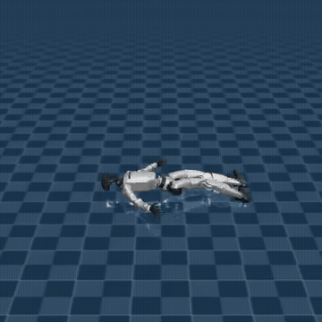
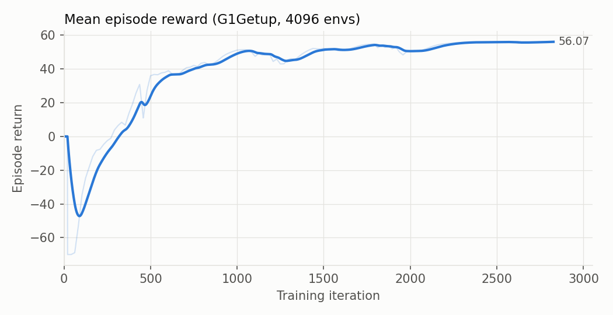
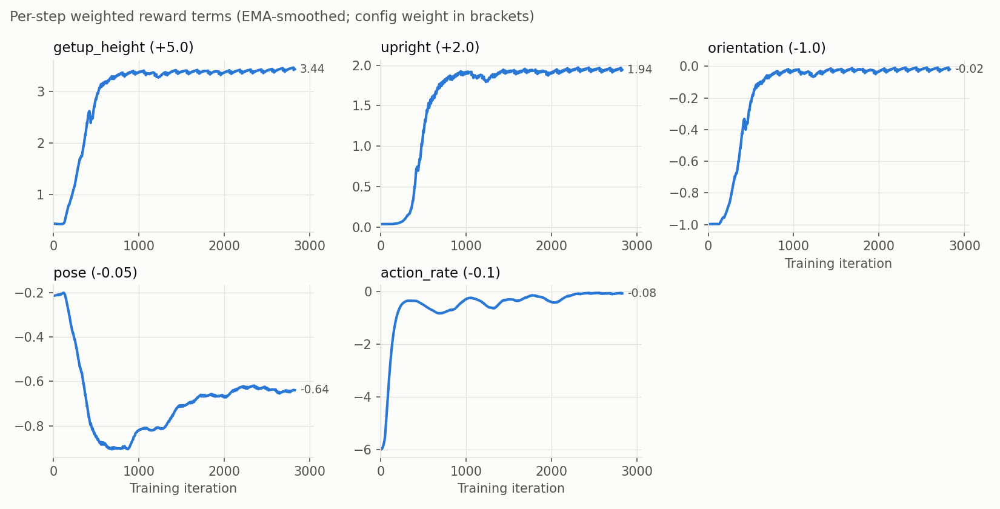

> **This fork adds a humanoid getting-up task to [UniLab](https://github.com/unilabsim/UniLab), ported from [HumanUP](https://github.com/RunpeiDong/HumanUP).**
> Everything below the line is the original UniLab README.

## G1 getting-up task (HumanUP → UniLab)

<p align="center">
  
</p>

This branch ports the getting-up task from **HumanUP** ([He, Dong et al., *Learning Getting-Up Policies for Real-World Humanoid Robots*, RSS 2025](https://arxiv.org/abs/2502.12152)) from Isaac Gym into UniLab's MuJoCo backend. It adds two tasks for the Unitree G1:

| Task | Start pose | HumanUP original |
|---|---|---|
| `g1_getup` | lying on its back (supine) | `g1waist` |
| `g1_rollover` | lying face down (prone) | `g1waistroll` |

The GIF shows the `g1_getup` policy after 2,825 APPO iterations: from lying flat, the robot reaches a crouch on its feet in under a second and holds it. **It does not stand fully upright yet.** The `getup_height` reward (+5.0) outweighs the much weaker `pose` penalty (−0.05). HumanUP gates its equivalent pose term on head height, which this port does not do yet.

### Training curves

4096 parallel environments, 2,825 iterations (~278M env steps), about 4.4 hours on one RTX 5090.

<p align="center"></p>
<p align="center"></p>

### What was added

- `src/unilab/envs/locomotion/g1/getup.py`: `G1GetupEnv`, shared by both tasks, with its rewards and config
- `src/unilab/assets/robots/g1/scene_getup.xml`: scene with `supine` / `prone` keyframes taken from HumanUP's fallen poses
- `conf/appo/task/g1_getup/mujoco.yaml`, `conf/appo/task/g1_rollover/mujoco.yaml`: task configs and reward weights
- `src/unilab/envs/locomotion/g1/__init__.py`: registers the new classes

### Run it

Built on UniLab commit [`22d735d`](https://github.com/unilabsim/UniLab/commit/22d735d98a7e8d80074a846b853db1f9effd6dc8). UniLab `main` was restructured after that commit, so this port won't apply to it as-is.

```bash
uv sync
uv run train --algo appo --task g1_getup --sim mujoco algo.num_envs=4096 algo.max_iterations=3000
uv run eval  --algo appo --task g1_getup --sim mujoco --render-mode record algo.load_run=-1 training.play_steps=500 training.play_env_num=1
```

### Differences from HumanUP

This is a port, not a faithful reproduction:
- no head-height reward (this repo's G1 model has no head body)
- no torque/energy rewards and no domain randomization
- only Stage I (getting up); HumanUP's Stage II (slower, smoother motion tracking) is not ported
- reward weights are a first, untuned attempt

### Credits

- **HumanUP**: Xialin He, Runpei Dong, Zixuan Chen, Saurabh Gupta. Task design, rewards and fallen poses. [Code](https://github.com/RunpeiDong/HumanUP) · [Paper](https://arxiv.org/abs/2502.12152) (Apache-2.0)
- **UniLab**: the training framework this runs on. [Code](https://github.com/unilabsim/UniLab) · [Paper](https://arxiv.org/abs/2605.30313) (Apache-2.0)

If you use this task, please cite HumanUP:

```bibtex
@article{humanup25,
  title={Learning Getting-Up Policies for Real-World Humanoid Robots},
  author={He, Xialin and Dong, Runpei and Chen, Zixuan and Gupta, Saurabh},
  journal={arXiv preprint arXiv:2502.12152},
  year={2025}
}
```

---

<h1 align="center"> UniLab </h1>

<h3 align="center">
A Heterogeneous Architecture for Robot RL Beyond GPU-Dominant Paradigms
</h3>

<p align="center">Languages: English | <a href="README_zh.md">简体中文</a></p>

<p align="center">
  <a href="https://unilabsim.github.io"></a>
  <a href="https://arxiv.org/abs/2605.30313"></a>
  <a href="https://unilabsim.github.io/paper/"></a>
  <a href="https://unilabsim.github.io/UniLab-doc/"></a>
  <a href="https://unilabsim.github.io/paper/paper2gal.html"></a>
  <a href="LICENSE"></a>
</p>

<p align="center">
  
</p>

<p align="center"><em>Train robot RL without a GPU simulation backend. Teaser rendered with MotrixSim.</em></p>

Start with the `Quick Demo` below to run the primary training command. The recommended setup uses `uv`; Conda and pip users should still follow the `uv` workflow for now. Platform-specific notes and current boundaries are in the [installation guide](https://unilabsim.github.io/UniLab-doc/en/1-getting_started/2-installation.html).

## ✨ Highlights

```
┌────────────────────┐                            ┌─────────────────────────┐
│   Uni Physics Sim  │   Unified Shared Memory    │   GPU Policy Training   │
│   Motrix / MuJoCo  │ ─────────────────────────▶ │     PPO / SAC / TD3     │
│   MjWarp / Drake   │    SharedReplayBuffer      │ CUDA / MPS / ROCm / XPU │
└────────────────────┘                            └─────────────────────────┘
```

- **Heterogeneous RL runtime:** CPU-parallel simulation streams transitions through shared memory while policy learning runs on GPU accelerators.
- **Two physics backends:** MuJoCoUni and MotrixSim are integrated through backend-specific adapters and task owner configs.
- **Unified training CLI:** `uv run train` and `uv run eval` cover PPO, APPO, SAC, TD3, and FlashSAC; additional HORA and HIM-PPO paths are documented as script-level workflows.
- **Config-owned tasks:** Hydra owner YAML files select task, reward, backend, and algorithm settings together; backend switching is expressed as `task=<task>/<backend>`.
- **Cross-platform setup paths:** The repository tracks Linux CUDA, Linux ROCm, Linux XPU, and Apple Silicon / macOS setup flows.

## 🚀 Quick Demo

<table>
  <tr>
    <td align="center" width="33%">
      
      <br>
      <sub><b>dance</b><br>G1 motion tracking</sub>
    </td>
    <td align="center" width="33%">
      
      <br>
      <sub><b>wallflip</b><br>G1 wall flip</sub>
    </td>
    <td align="center" width="33%">
      
      <br>
      <sub><b>teaser</b><br>MotrixSim teaser</sub>
    </td>
  </tr>
  <tr>
    <td align="center" width="33%">
      
      <br>
      <sub><b>boxtracking</b><br>G1 box tracking</sub>
    </td>
    <td align="center" width="33%">
      
      <br>
      <sub><b>inhandgrasp</b><br>Sharpa in-hand</sub>
    </td>
    <td align="center" width="33%">
      
      <br>
      <sub><b>locomani</b><br>Go2 loco-manipulation</sub>
    </td>
  </tr>
</table>

```bash
# 0. Install uv if needed
# Linux / macOS:
curl -LsSf https://astral.sh/uv/install.sh | sh

# Windows:
# powershell -ExecutionPolicy ByPass -c "irm https://astral.sh/uv/install.ps1 | iex"
# choco install make -y

# 1. Clone the repository
git clone https://github.com/unilabsim/UniLab.git
cd UniLab

# 2. Install dependencies
# Pick the setup command for your platform.
#
# Prerequisite: the `mujoco` extra compiles a native extension during `uv sync`
# and needs Python development headers when using a system Python:
#   Ubuntu / Debian: sudo apt-get install build-essential python3-dev
#   macOS:           xcode-select --install
#   Windows:         MSVC Build Tools
# (uv-managed Pythons from `uv python install` already bundle the headers.)

# Linux CUDA, macOS, or Windows
make setup

# Linux AMD / ROCm
# make sync-rocm

# Linux Intel Arc / iGPU
# make sync-xpu

# Without shell completion setup:
# uv sync --extra mujoco --extra motrix
# If `make` is not installed or unavailable:
# uv sync --extra mujoco --extra motrix && uv run --no-sync unilab-complete install

# 3. Pre-trained checkpoint playback (downloads from Hugging Face on first run)
uv run demo dance
```

Available demo names: `teaser`, `dance`, `wallflip`, `boxtracking`, `locomani`, `inhandgrasp`. See the [Unified CLI](https://unilabsim.github.io/UniLab-doc/en/2-user_guide/1-training/1-cli_reference.html) page for the full list and flags.

> Mainland China users: motions, scenes, robot meshes, and demo checkpoints are pulled from Hugging Face on first run. If `huggingface.co` is unreachable, point the client at the community mirror before running demo commands:
>
> ```bash
> export HF_ENDPOINT=https://hf-mirror.com
> ```

For training and evaluation:

```bash
uv run train --algo appo --task go2_joystick_flat --sim motrix

uv run eval --algo appo --task go2_joystick_flat --sim motrix --load-run -1

# Headless Motrix video export for Linux/server runs
uv run eval --algo appo --task go2_joystick_flat --sim motrix --load-run -1 --render-mode record
```

This routes through the `go2_joystick_flat/motrix` task owner config and keeps backend selection explicit. Each backend owner carries an optional `play_profile` block that layers render-only overrides at eval time (`training.play_only=true`) without affecting training.

On macOS / MacBook, the UniLab CLI routes Motrix interactive playback through `mxpython` when needed. Motrix defaults to interactive playback; use `--render-mode record` for headless video export or `--render-mode none` to skip playback. Detailed script-level commands are in the [Training Guide](https://unilabsim.github.io/UniLab-doc/en/2-user_guide/1-training/0-index.html).

## 🏃 Example Runs

```bash
uv run train --algo sac --task g1_walk_flat --sim mujoco
uv run train --algo flashsac --task g1_walk_flat --sim mujoco
```

```bash
uv run train --algo sac --task g1_motion_tracking --sim motrix
```

```bash
uv run train --algo appo --task sharpa_inhand --sim mujoco --profile hora
```

> Grasp caches auto-download from Hugging Face (`unilabsim/unilab-caches`) on first run into `src/unilab/assets/caches/`; no manual step is needed. To regenerate locally for custom scales (slow):
> ```bash
> bash scripts/sharpa_collect_grasps.sh 0.8 0.9 1.0 1.1 1.2 1.3 1.4 1.5
> ```

```bash
uv run train --algo ppo --task go2_arm_manip_loco --sim motrix
uv run eval --algo ppo --task go2_arm_manip_loco --sim motrix --load-run -1
```

```bash
uv run train --algo ppo --task go2_joystick_flat --sim mujoco 'training.devices=[0,1]'
uv run train --algo flashsac --task g1_walk_flat --sim mujoco training.devices="[0,1,2,3]"
uv run train --algo sac --task g1_motion_tracking --sim mujoco training.devices="[0,1,2,3,4,5,6,7]"
```

Use `uv run train` for training, `uv run eval` for checkpoint playback, and `uv run demo` for the local demo preset. These commands keep algorithm, task, and backend selection explicit.

More training commands, script-level entrypoints, algorithm matrix, resume flow, and W&B details are in the [Training Guide](https://unilabsim.github.io/UniLab-doc/en/2-user_guide/1-training/0-index.html).

## 📚 Documentation

Use the published [UniLab documentation](https://unilabsim.github.io/UniLab-doc/); start at the [English documentation index](https://unilabsim.github.io/UniLab-doc/en/0-index.html). High-signal entrypoints:

- [Getting Started](https://unilabsim.github.io/UniLab-doc/en/1-getting_started/0-index.html): installation, Docker runtime, dependency setup, and first-run commands
- [Training Guide](https://unilabsim.github.io/UniLab-doc/en/2-user_guide/1-training/0-index.html): training, playback, resume flow, Hydra overrides, and W&B
- [Simulation Backends](https://unilabsim.github.io/UniLab-doc/en/2-user_guide/3-backends/0-index.html): generated MuJoCo / Motrix support matrix
- [Development Standard](https://unilabsim.github.io/UniLab-doc/en/4-developer_guide/0-index.html): contracts, layering, and validation boundaries
- [ADR Index](https://unilabsim.github.io/UniLab-doc/adr/ADR-0000-index.html): accepted architecture decisions

## 💬 Community

<p align="center">
  
</p>

<p align="center">Add the assistant on WeChat to join the group. Please include <code>UniLab community</code> in your request.</p>

## 🧾 Citation

### UniLab

```bibtex
@article{jia2026unilab,
  title         = {UniLab: A Heterogeneous Architecture for Robot RL Beyond GPU-Dominant Paradigms},
  author        = {Yufei Jia and Zhanxiang Cao and Mingrui Yu and Heng Zhang and Shenyu Chen and Dixuan Jiang and Meng Li and Xiaofan Li and Yiyang Liu and Junzhe Wu and Zheng Li and XiLin Fang and Tingyu Cui and Shengcheng Fu and Haoyang Li and Anqi Wang and Zifan Wang and Dongjie Zhu and Chenyu Cao and Zhenbiao Huang and Ziang Zheng and Jie Lu and Xin Ma and Zhengyang Wei and Xiang Zhao and Tianyue Zhan and Ye He and Yuxiang Chen and Yizhou Jiang and Yue Li and Haizhou Ge and Yuhang Dong and Fan Jia and Ziheng Zhang and Meng Zhang and Xiwa Deng and Zhixing Chen and Hanyang Shao and Chenxin Dong and Yixuan Li and Yizhi Chen and Bokui Chen and Kaifeng Zhang and Hanqing Cui and Yusen Qin and Ruqi Huang and Lei Han and Tiancai Wang and Xiang Li and Yue Gao and Guyue Zhou},
  journal       = {arXiv preprint arXiv:2605.30313},
  year          = {2026},
  url           = {https://arxiv.org/abs/2605.30313}
}
```

### Physics Backends

```bibtex
@article{jia2026mujocouni,
  title  = {MuJoCoUni: Persistent Batched Runtime Primitives for MuJoCo},
  author = {Jia, Yufei and Wu, Junzhe},
  journal = {arXiv preprint arXiv:2605.24922},
  year   = {2026}
}

@software{motrixsim2026,
  title  = {MotrixSim: A Physics Simulation Engine for Robotics and Embodied AI},
  author = {{Motphys Team}},
  year   = {2026},
  url    = {https://motrixsim.readthedocs.io/},
  note   = {Python binary package}
}
```
